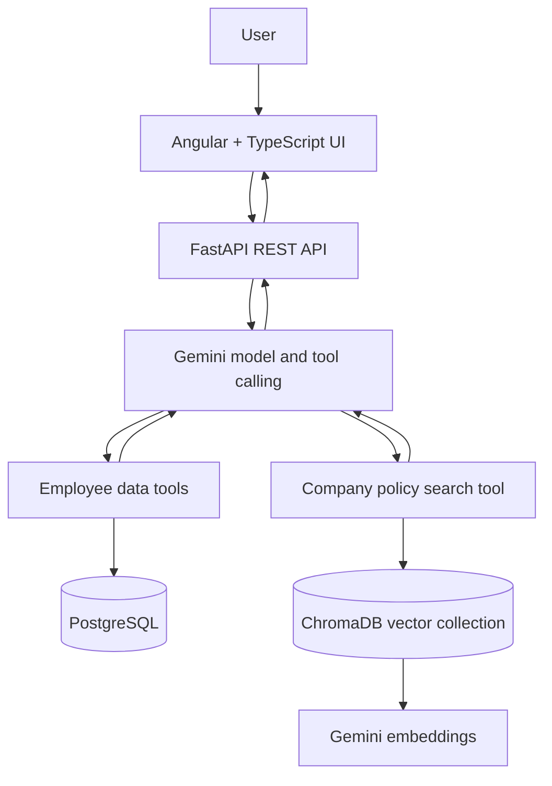

# Employee AI Assistant

An AI-powered employee assistant that answers natural-language questions about employee data and company policies. The project combines **Gemini tool calling**, **PostgreSQL**, **ChromaDB-based semantic retrieval**, and an **Angular + FastAPI** application.

> Learning project built with synthetic demonstration data. It is not a production HR system.

## What it does

- Answers natural-language questions about employee records.
- Uses Gemini function/tool calling to select backend functions for data questions.
- Queries PostgreSQL for employee lookups and salary analytics.
- Retrieves relevant company-policy content from ChromaDB using Gemini embeddings.
- Handles questions that require both employee data and policy context.
- Provides an Angular and TypeScript chat interface backed by a FastAPI REST API.

## Architecture



### Request flow

1. The user submits a question in the Angular interface.
2. FastAPI passes the question to the Gemini-powered agent.
3. The model selects the relevant tool or tools for the question.
4. Employee tools query PostgreSQL; policy search retrieves relevant policy content from ChromaDB.
5. The model uses the tool results to compose a natural-language answer.

The application is designed to ground answers in tool results rather than hardcode responses for particular question keywords.

## Technology stack

| Layer | Technologies |
|---|---|
| Frontend | Angular, TypeScript |
| Backend | Python, FastAPI, Uvicorn |
| LLM and tool calling | Google Gemini, Google GenAI SDK |
| Relational data | PostgreSQL |
| Policy retrieval | ChromaDB, Gemini embeddings (`gemini-embedding-001`) |

## Example questions

Try questions such as:

- “What is Rahul Sharma's current salary?”
- “How many active employees are there?”
- “What is the average salary by department?”
- “What is the company's work-from-home policy?”
- “Can Rahul Sharma work from home, and what is his current salary?”

The last example requires employee data and policy context. The employee records and policies are synthetic demonstration data.

## Getting started

### Prerequisites

- Python 3.10 or later
- Node.js and npm compatible with the Angular project
- PostgreSQL
- A Google Gemini API key

### 1. Clone the repository

```bash
git clone https://github.com/snake0507/employee-ai-assistant.git
cd employee-ai-assistant
```

### 2. Configure the backend

Create and activate a virtual environment.

**Windows PowerShell**

```powershell
python -m venv venv
.\venv\Scripts\Activate.ps1
pip install -r requirements.txt
copy .env.example .env
```

**macOS / Linux**

```bash
python -m venv .venv
source .venv/bin/activate
pip install -r requirements.txt
cp .env.example .env
```

Edit `.env` and supply your own credentials. The expected variables are:

- `GEMINI_API_KEY`
- `POSTGRES_HOST`
- `POSTGRES_PORT`
- `POSTGRES_DB`
- `POSTGRES_USER`
- `POSTGRES_PASSWORD`

Never commit your real `.env` file, API keys, or database passwords.

### 3. Prepare PostgreSQL

Start PostgreSQL, create the database configured in your environment (the example uses `employee_analytics`), and create an `employees` table with the columns expected by the backend:

`id`, `full_name`, `department`, `salary`, and `active`.

Insert synthetic demonstration records before testing employee questions. Use the schema and query expectations in the backend code as the source of truth if you customize the database.

### 4. Ingest policy documents

From the repository root, run:

```bash
python ingest_policies.py
```

The ingestion script reads `employee_policies.txt`, creates embeddings, and stores policy sections in the persistent ChromaDB collection `company_policies`. Run ingestion again after changing the policy source file. This step requires a valid Gemini API key and should be completed before starting the backend.

### 5. Start the backend

From the repository root:

```bash
uvicorn main:app --reload
```

The API is available at `http://127.0.0.1:8000`. If enabled in the current backend version, check health at `http://127.0.0.1:8000/api/health`.

### 6. Start the frontend

Open a second terminal:

```bash
cd frontend
npm install
npm start
```

Open `http://localhost:4200`. The frontend is configured to call the local backend API at `http://127.0.0.1:8000/api`.

## Repository structure

```text
employee-ai-assistant/
├── frontend/              # Angular + TypeScript client
├── main.py                # FastAPI application
├── ingest_policies.py     # Policy embedding and ingestion
├── employee_policies.txt  # Synthetic policy source content
├── requirements.txt       # Python dependencies
├── .env.example           # Environment-variable template
└── README.md
```

Some modules may be added or renamed as development continues; the file tree above highlights the main entry points.

## Security and limitations

- Use synthetic or explicitly authorized data only.
- Keep secrets in local environment variables; do not commit `.env`.
- This project is for learning and demonstration, not production HR use.
- Before production use, add authentication and authorization, input and output validation, robust error handling, logging/monitoring, rate limits, automated tests, and a formal evaluation of retrieval and answer quality.
- If a credential has ever been committed to Git, rotate it. Deleting it from the latest version does not remove it from Git history.

## Author

**Mohit Ajay Patil**

- GitHub: [@snake0507](https://github.com/snake0507)
- Project repository: [employee-ai-assistant](https://github.com/snake0507/employee-ai-assistant)
